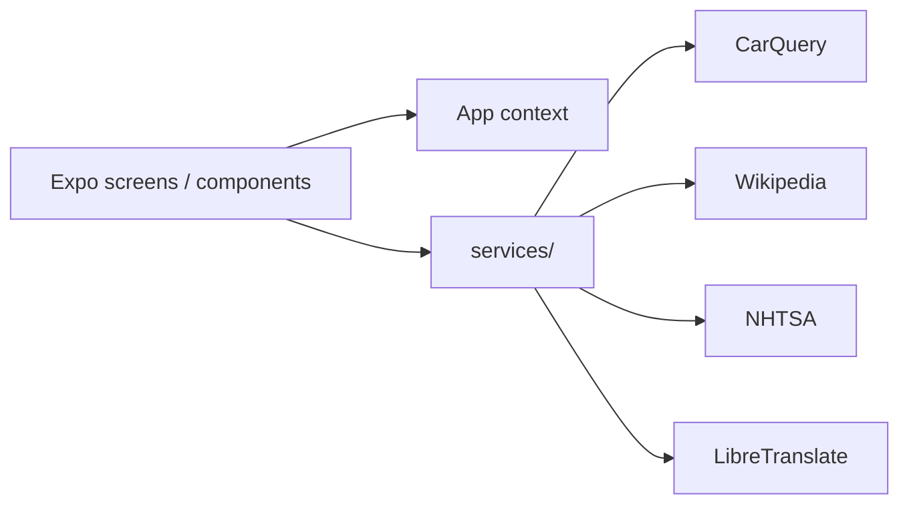

# Carpedia

Mobile encyclopedia for cars — look up vehicle makes/models and related public data from multiple APIs.

## Problem / What it does

Drivers and enthusiasts often need to combine brand/model catalogs, encyclopedia-style background, and safety/regulatory data in one place. Carpedia is a React Native (Expo) app that queries public automotive APIs and presents vehicle details with theming and browse history.

## Key features

- Vehicle make/model lookup via CarQuery API
- Additional context via Wikipedia API
- Safety/regulatory info via NHTSA Vehicle API
- Translation support via LibreTranslate API
- Screens for search/home, vehicle details, and history
- Multiple UI themes (`chatgpt`, `copilot`, `light`) with styled-components
- Context-based app state for theming and history
- Expo Router navigation (tabs + detail routes)

## Tech stack

- **App:** React Native, Expo, Expo Router, TypeScript
- **UI:** styled-components, React Navigation, Expo UI packages (image, blur, haptics, etc.)
- **HTTP:** Axios
- **Tooling:** ESLint (expo config)

> Note: the private README mentions React Query; it is not present in `package.json` dependencies, so it is omitted from this tech stack.

## Architecture overview

Folders evidenced: `app/`, `components/`, `services/`, `context/`, `themes/`, `hooks/`, `styles/`, `types/`, `utils/`.

## My role

Designed and built by Anderson Henrique Gonçalves.

## Status

In development — basic features are in place per project README; structure/theming work and automated tests/app-store deploy still planned.

## Source code

Source code is private. Available for walkthrough on request.

- LinkedIn: https://www.linkedin.com/in/andersonhenriquegoncalves
- GitHub: https://github.com/anderzilla
